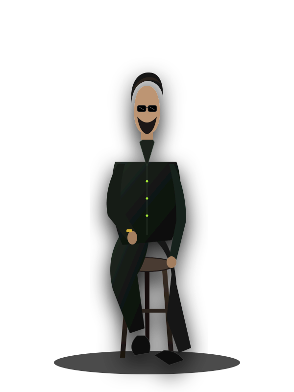

# Mirsha VP — AI Content Creator & Graphic Designer Portfolio

A personal portfolio website for **Mirsha VP**, crafted in the dark forest green / noir aesthetic inspired by the reference design.



---

## 🌟 Features Included

- **Reference Design Matching**:
  - Deep dark moss/forest green radial canvas (`#070e09`, `#0d1710`, `#14281a`) with electric lime accents (`#a3e635`).
  - Floating frosted-glass pill navbar with active section indicator and "Get in touch ➔" button.
  - Hero Section with bold modern typography (`Ai Content Creator`), center studio portrait with radial spotlight, editorial serif quote (*"Great AI visuals should feel invisible"*), and 4 numbered bottom category pillars (`#01` to `#04`).
  - About Me Section with 2-column layout:
    - Left: Portrait card with badge (`● Graphic Design & AI Creation`) and credentials glass card (Education: *BA Graphic Design & Animation*, Expertise: *Graphic Design & AI Content Creation*, Core Disciplines).
    - Right: Serif quote (*“Turning creative ideas into powerful visual experiences.”*), detailed bio, *"My Goal Is Simple"* highlight box, and skill tag pills.
- **5 Specialized Services**:
  1. *AI Content Creation*
  2. *AI Advertising*
  3. *AI Product Content*
  4. *AI Video Production*
  5. *Prompt Engineering*
- **Technical Skills & Tools Ecosystem**:
  - Interactive skill progress indicators (AI Video Creation, Meta Ads, Vibe Coding, Graphic Design, etc.).
  - 11 Specialized Tools categorized with custom brand icons:
    - **Reasoning & LLMs**: ChatGPT, Gemini, Claude
    - **AI Video & Image**: Kling AI, Nano Banana, OmniFlash, Seedance, Flow
    - **Design & Post-Production**: Photoshop, Canva, CapCut
- **Why Work With Me**:
  - 01. *Creativity with Purpose*
  - 02. *AI-Powered Innovation*
  - 03. *Attention to Detail*
- **Featured Portfolio & Projects**:
  - **Dxb iHub** (AI Visual Direction & Innovation Branding)
  - **Accubate Health Care** (AI Medical Storytelling & Social Advertising)
  - **VILAVIL** (Luxury AI Product Content & Commercial Cinema)
  - Interactive Case Study Lightbox modal with strategy, tools, and results!
- **Client Testimonials**:
  - Featured: *“Very creative, professional, and easy to work with.”*
- **Contact & Conversion ("LET'S TURN YOUR IDEAS INTO REALITY")**:
  - Direct WhatsApp link & dial: `+91 8137001487`
  - Email with one-click copy & mailto: `wwwmirsha7123@gmail.com`
  - Instagram link: `@ai.mirshhh`
  - Interactive project inquiry form with instant WhatsApp messaging launch.
- **Interactive Photo Customizer**:
  - Click the **"Customize Photos"** floating pill (bottom-left) or the **"📷 Change Photo"** button on the hero/about portrait to upload any photo directly in the browser!
  - Automatically updates the site and saves your photo in browser `localStorage`.
  - Also supports placing `assets/images/mirsha-hero.png` and `assets/images/mirsha-about.jpg` in the project files.

---

## 🚀 How to Run Locally

You can simply double-click `index.html` to open it in Chrome, Safari, or your favorite web browser.

Alternatively, to serve with Python:

```bash
cd "/Users/mirshavp/Downloads/MIRSHA PORTFOLIO"
python3 -m http.server 3000
```

Then visit [http://localhost:3000](http://localhost:3000) in your browser.

---

## 📁 Project Structure

```
MIRSHA PORTFOLIO/
├── index.html                 # Main website markup
├── css/
│   └── style.css              # Custom styling, animations & theme system
├── js/
│   └── main.js                # Interactivity, photo uploader & modals
├── assets/
│   ├── icons/                 # Custom SVG tool icons (ChatGPT, Kling, etc.)
│   ├── images/                # Project covers & portrait illustrations
│   └── reference/             # Original reference screenshots
└── scripts/
    ├── generate_assets.py     # Asset builder
    └── generate_tool_icons.py # Tool icon generator
```
